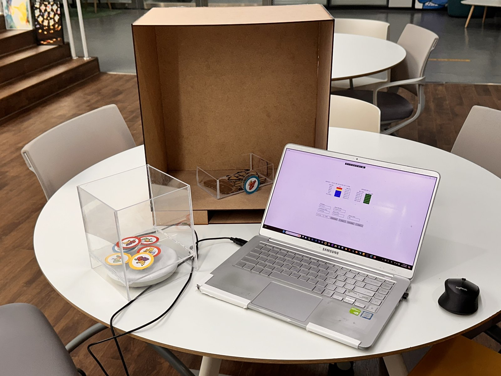
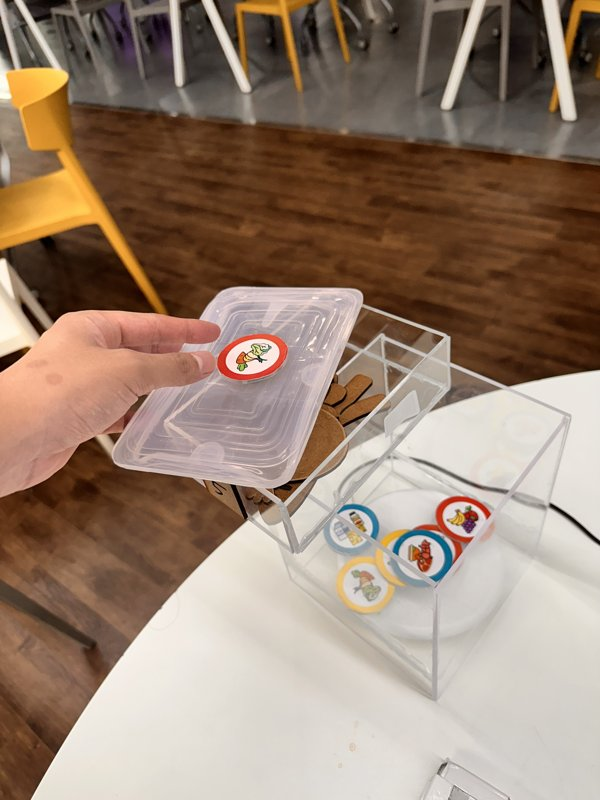
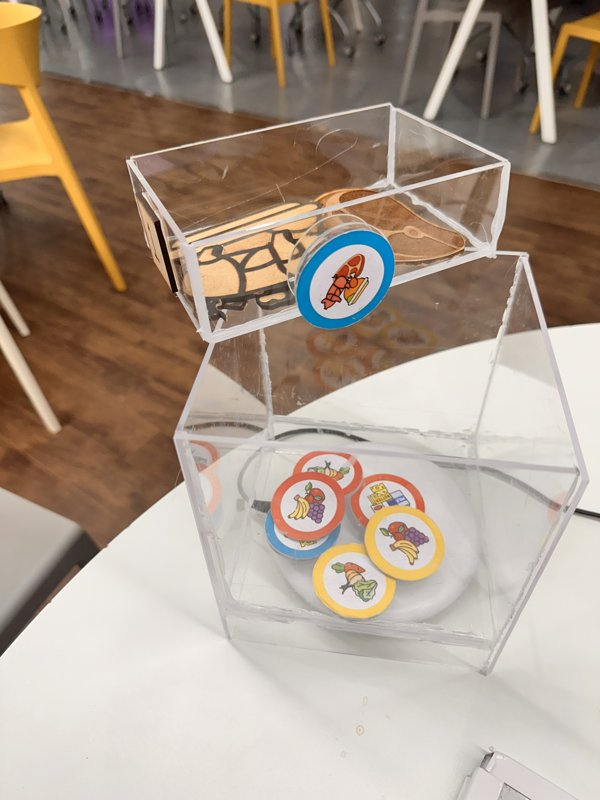
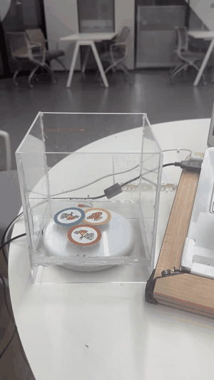
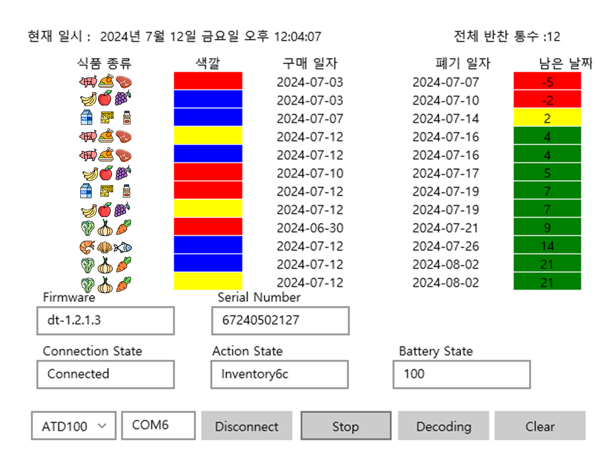
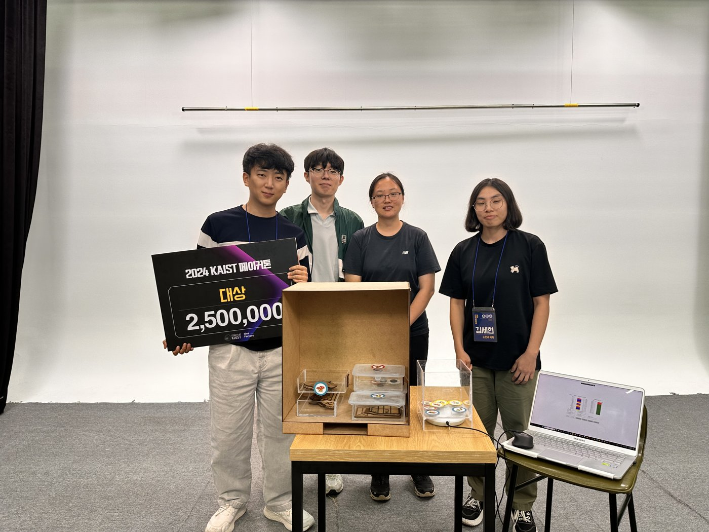

# 웬 투 잇 · When to Eat

**냉장고를 알려줘 — RFID 토큰으로 식품의 보관 기한을 확인하는 냉장고 관리 시제품**

2024 KAIST 메이커톤 **대상 수상 · 상금 250만 원** | 팀 **노인과 바둑**

[](media/photos/prototype/prototype-system-overview-01.jpeg)

[시연 영상](#시연) · [최종 발표 자료](DesignAndPresentation/웬투잇.pptx) · [사진·영상 전체 목록](media/README.md)

## 프로젝트 소개

고령자가 냉장고 안에 어떤 식품을 얼마나 오래 보관했는지 쉽게 파악하도록 만든 프로젝트입니다. 식품 그림이 있는 재사용 RFID 토큰을 용기에 붙이면, 보관함의 리더와 연결된 화면에서 사용 중인 용기와 남은 보관 기간을 확인할 수 있습니다.

냉장고 목업, 토큰과 부착 장치, RFID 리더, Windows 식품 관리 GUI를 제작해 메이커톤에서 시연했습니다.

## 사용 방법

1. **토큰 선택** — 식품 종류에 맞는 그림 토큰을 RFID 보관함에서 꺼냅니다.
2. **용기에 부착** — 토큰을 용기에 붙이고 식품을 보관합니다. 보관함에서 빠진 토큰이 사용 중인 목록에 등록되며 보관 기간 계산이 시작됩니다.
3. **확인 후 반환** — 화면에서 남은 날짜를 확인합니다. 식품을 다 사용하면 토큰을 보관함에 돌려놓아 목록에서 제외하고, 다음 사용을 준비합니다.

### 용기에 맞춰 붙이는 토큰

| 뚜껑에 부착 | 용기 측면에 부착 |
| :---: | :---: |
| [](media/photos/attachments/vegetable-token-on-container-lid-01.jpeg) | [](media/photos/attachments/meat-token-on-container-side-01.jpeg) |

발표 자료에서는 다양한 용기에 씌우는 실리콘 덮개형과 용기에 붙이는 자석형 부착 방식을 제안했습니다. 토큰의 그림은 식품 종류를, 테두리 색은 토큰을 구분하는 데 사용합니다.

## 시연

### RFID 리더와 식품 관리 화면

아래 미리보기는 약 12초 분량의 세로 시연 영상을 축소한 GIF입니다. 클릭하면 소리가 포함된 원본 MOV를 열 수 있습니다.

[](media/videos/demo/rfid-reader-and-gui-demo.mov)

[시연 원본 보기](media/videos/demo/rfid-reader-and-gui-demo.mov) · [초기 식품 목록 갱신 테스트](media/videos/demo/food-list-update-test.mov) · [행사 영상](media/README.md#영상)

### 식품 관리 GUI



*최종 발표 자료에 수록한 시연 화면입니다. 식품 아이콘 표시는 현재 저장소의 소스에서 주석 처리되어 있습니다.*

- 사용 중인 용기의 수와 식품 목록을 표시하고, 남은 날짜가 적은 순서로 정렬합니다.
- 식품 종류, 토큰 색, 시작일, 폐기 예정일과 남은 날짜를 확인할 수 있습니다.
- 남은 날짜는 **기한 경과: 빨강 / 0~2일: 노랑 / 3일 이상: 초록**으로 표시합니다. 이 상태 색은 토큰의 테두리 색과 별개입니다.
- 리더 연결 상태, 동작 상태와 배터리 상태를 표시합니다.

## 팀과 수상

[](media/photos/awards/team-with-prototype-landscape.jpeg)

| 팀원 | 영문 이름 | 역할 |
| --- | --- | --- |
| 전상언 | Sangeon Jeon | 팀장 |
| 김세현 | Sehyeon Kim | 팀원 |
| 정병영 | Byeongyoung Jeong | 팀원 |
| 박유진 | Yujin Park | 팀원 |

2024 KAIST 메이커톤에서 대상을 수상했습니다. [수상 보드 원본](media/photos/awards/grand-prize-board.jpeg)에서 상금 **2,500,000원**을 확인할 수 있습니다.

## 저장소 구성

```text
.
├── Code/                         # Windows UWP C# / XAML 소스
├── DesignAndPresentation/        # 최종 발표와 제작 도면
│   ├── 웬투잇.pptx
│   ├── TokenDesign.pdf
│   └── Model Refrigerator Lasar Cutting View.pdf
├── media/
│   ├── README.md                 # 원래 파일명, 새 경로와 장면 설명
│   ├── photos/                   # 원본 사진 26장
│   │   ├── development/
│   │   ├── tokens/
│   │   ├── attachments/
│   │   ├── prototype/
│   │   ├── awards/
│   │   └── event/
│   ├── videos/                   # 원본 영상 4개
│   │   ├── demo/
│   │   └── event/
│   └── previews/                 # README용 축소 사진, GIF와 GUI 이미지
├── KAIST Makerathon.pptx          # 초기 기획 자료
├── KAIST Makerathon (2).pptx      # 추가 기획 자료
└── KAIST Makerathon.pdf           # 기획 자료 PDF
```

| 자료 | 내용 |
| --- | --- |
| [최종 발표](DesignAndPresentation/웬투잇.pptx) | 문제 정의, 사용 흐름, 구현 결과와 향후 계획 |
| [토큰 도면](DesignAndPresentation/TokenDesign.pdf) | 토큰 제작용 디자인 |
| [냉장고 목업 도면](DesignAndPresentation/Model%20Refrigerator%20Lasar%20Cutting%20View.pdf) | 모형 제작용 레이저 커팅 도면 |
| [사진·영상 자료실](media/README.md) | 장면별 분류와 원래 파일명 대조표 |

## 소프트웨어와 실행 준비

GUI는 **Windows UWP · C# · XAML**로 작성했으며, **ATID ATD100 UHF RFID 리더**와 가상 COM 포트로 통신합니다. 화면은 [MainPage.xaml](Code/MainPage.xaml), 토큰 상태와 식품 목록 관리는 [ReaderViewModel.cs](Code/ReaderViewModel.cs)에 구현되어 있습니다.

이 저장소에는 `.sln`, `.csproj`, 앱 매니페스트와 ATID SDK가 포함되어 있지 않아 단독으로 빌드할 수 없습니다. 기존에 안내한 기반 프로젝트는 [Google Drive 폴더](https://drive.google.com/drive/folders/18IRY2AfHl9cmScwam55FEvZh57e8WAxe)에서 확인할 수 있습니다.

1. Windows에서 UWP 개발을 지원하는 Visual Studio, 원본 UWP 프로젝트와 호환되는 ATID SDK를 준비합니다.
2. 원본 프로젝트의 대응하는 파일을 이 저장소의 `Code/` 파일로 교체합니다.
3. 리더를 연결하고 COM 포트를 확인합니다. 코드의 기본값은 `COM6`이며, 실제 장치와 토큰의 RFID 식별자에 맞게 설정을 수정합니다.
4. 앱을 실행해 리더를 선택하고 **Connect → Inventory6c** 순서로 연결·인식을 시작합니다.

### 현재 구현 범위

현재 소스는 12개의 샘플 토큰과 고정된 시연용 보관 기간을 사용합니다. 목록은 메모리에서 관리하며, 데이터베이스 저장 기능은 포함되어 있지 않습니다. 바코드 디코딩 콜백은 미구현 상태입니다.

발표 자료의 **냉장고 경고음, 모바일 앱·위젯, 토큰 종류 확대**는 향후 확장 계획입니다.
